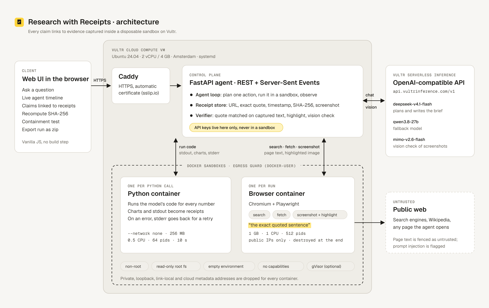

# Research with Receipts

**Research where every claim comes with a verifiable receipt.**

Ask a question. An agent plans the research on Vultr Serverless Inference, then does all the work inside disposable sandboxes on a Vultr VM: it searches, opens pages in a real headless browser, and runs Python for any arithmetic. The answer is a short brief whose every claim links to a **receipt**: the source URL, the exact quote, a screenshot with that quote highlighted, a timestamp and a SHA-256 hash, or the code and output that produced a number. Each claim is then checked mechanically against its receipts and marked `verified`, `partial` or `unverified`.

## Live demo

**https://78-141-218-240.sslip.io** (Vultr Cloud Compute, Amsterdam)

Running a query needs an **access code**, which keeps the Vultr inference credits safe from abuse. Type it in the **Access code** field at the top of the question box, just above the question and the **Research** button. The browser remembers it after the first accepted run. The code comes with the hackathon submission and is not in this repository.

When you self-host, leave `APP_ACCESS_CODE` empty in `.env` to turn the code off.

## Architecture



Diagram source: [`docs/architecture.svg`](docs/architecture.svg).

**The loop.** The model answers with one JSON action at a time (`search`, `fetch`, `screenshot`, `python`, `final`), so any OpenAI-compatible model works. The control plane runs each action in the run's sandbox and turns every page read and every Python run into a receipt. Page text goes back to the model fenced as untrusted content. When code fails, stderr goes back and the model fixes it. For the final answer, the sandboxed browser re-opens each source, highlights the quoted sentence and screenshots it. Each quote is matched against the captured text, and an optional vision model checks the screenshot. Then the sandbox is destroyed.

**Containment.**

| Threat | What stops it |
|---|---|
| Keys stolen by a page or by model-written code | Containers start with an empty environment; keys stay in the control plane |
| `rm -rf /` | Non-root user, read-only root filesystem, throwaway container |
| Infinite loop, fork bomb, memory bomb | Timeouts that force-remove the container, `--pids-limit`, `--memory` |
| Exfiltration from code | Python containers run with `--network none` |
| SSRF to cloud metadata or localhost | Every request and redirect is resolved and private, loopback and link-local IPs are refused; the VM also drops those ranges for containers (`DOCKER-USER`) |
| Prompt injection | Content fenced as untrusted, injection flagged in the live log, and there is nothing to leak |
| Kernel escape | Optional gVisor runtime (`SANDBOX_RUNTIME=runsc`) or sandboxes on a separate throwaway Vultr VM (`scripts/vultr_sandbox_vm.py`) |

Every run streams its timeline over Server-Sent Events. Any recorded run can be replayed through the same pipeline, labelled as a replay. **Receipts .zip** exports a run with every receipt, an offline report and a verifier that needs only Python:

```bash
unzip receipts-<run-id>.zip -d run && cd run && python verify_bundle.py   # recomputes every SHA-256, then prints e.g. "8/8 receipts verified"
```

## Requirements

- Python 3.11 or newer
- Docker, for the real sandbox (without it a labelled mock sandbox is used)
- A Vultr Serverless Inference API key, for the real model (without it a labelled mock policy is used)

## Run it locally

```bash
git clone https://github.com/ADreLOI/research-with-receipts && cd research-with-receipts
cp .env.example .env
./scripts/dev.sh                    # creates .venv, installs requirements, serves http://127.0.0.1:8000
```

That runs fully offline: a labelled mock policy plans the research and, without Docker, a labelled mock sandbox serves fixture pages. The three demo questions also replay their recorded live runs. To use the real sandbox and model:

```bash
./scripts/build_sandbox.sh          # builds rwr-sandbox:latest (Chromium, Playwright, Python toolbox)
# in .env: VULTR_INFERENCE_API_KEY=...  (Vultr portal > Serverless > Inference)
python scripts/doctor.py            # checks config, Docker, inference and the sandbox tools
SANDBOX_BACKEND=docker ./scripts/dev.sh
```

## Configuration

Everything is an environment variable, documented in [`.env.example`](.env.example). The ones that matter most:

| Variable | Purpose |
|---|---|
| `VULTR_INFERENCE_API_KEY` | Serverless Inference key. Lives only in the control plane, never in a sandbox |
| `LLM_MODEL`, `LLM_FALLBACK_MODEL`, `VISION_MODEL` | Planner, fallback and screenshot-check models (empty = picked from the live model list) |
| `LLM_MAX_TOKENS`, `VISION_MAX_TOKENS` | Token budgets (4000 and 1500; reasoning models need room) |
| `SANDBOX_BACKEND` | `docker` or `mock` (`auto` uses Docker when the daemon and the sandbox image exist) |
| `SANDBOX_RUNTIME` | `runsc` to run sandboxes under gVisor |
| `SANDBOX_DOCKER_HOST` | Run sandboxes on another host, such as a throwaway Vultr VM |
| `SEARCH_PROVIDER`, `BRAVE_SEARCH_API_KEY` | Keyless search by default (DuckDuckGo, then Wikipedia); Brave with a key |
| `DEMO_MODE` | `auto` replays a recorded run when the live model is unreachable |
| `APP_ACCESS_CODE` | Code required to start runs on a public URL (empty = open) |

## Deploy on Vultr

On a Cloud Compute VM (Ubuntu 24.04, 2 vCPU / 4 GB):

```bash
git clone https://github.com/ADreLOI/research-with-receipts /opt/rwr && cd /opt/rwr
sudo bash deploy/setup_vultr_vm.sh <ip-with-dashes>.sslip.io   # Docker, egress guard, image, systemd, Caddy + HTTPS
sudo nano /opt/rwr/.env                                         # VULTR_INFERENCE_API_KEY, APP_ACCESS_CODE
sudo systemctl restart rwr
sudo -u rwr .venv/bin/python scripts/doctor.py
```

Add `INSTALL_GVISOR=1` before the setup command to install gVisor, then set `SANDBOX_RUNTIME=runsc`. Later updates: `sudo bash deploy/update.sh`. To keep sandboxes off the app VM entirely, `scripts/vultr_sandbox_vm.py` creates a separate throwaway Vultr VM through the Vultr API (needs `VULTR_API_KEY`).

## API

| Endpoint | What it does |
|---|---|
| `GET /api/health` | Sandbox backend, model status, limits, whether an access code is needed |
| `POST /api/runs` | Start a run: `{"question": "...", "mode": "auto"}`, header `X-Access-Code` when required |
| `GET /api/runs/{id}/events` | Live timeline as Server-Sent Events |
| `GET /api/runs/{id}` | Answer, claims with verification, receipts |
| `GET /api/runs/{id}/receipts/{rid}/verify` | Recompute a receipt's SHA-256 on the server |
| `GET /api/runs/{id}/export` | Zip with every receipt, an offline report and `verify_bundle.py` |
| `GET /api/containment-test` | Throw eight attacks at a fresh sandbox, streamed |

## Project layout

```
app/              FastAPI control plane: agent loop, prompts, receipts, verification, export
app/providers/    Vultr Serverless Inference client, mock policy, record and replay
app/sandbox/      Docker sandbox (hardened docker run / exec), mock sandbox, replay
sandbox_image/    Sandbox image: Chromium, Playwright, Python toolbox and the in-container worker
web/              Single-page UI (vanilla JS, no build step)
deploy/           VM setup, Caddy, systemd units, egress guard, update script
scripts/          dev server, doctor, demo and recording, containment test, throwaway sandbox VM
demo/             Hostile demo page and recorded runs used for replay
tests/            Offline test suite
docs/             Architecture diagram and its source
```

## Tests

```bash
pip install -r requirements-dev.txt
pytest -q
```

The suite runs offline with mock model and sandbox doubles. It covers the agent loop, quote matching and verification, receipts and hashes, replay, the API and the sandbox worker's search fallbacks.

## Demo questions

`python scripts/demo.py [1|2|3]` runs them from the terminal against a running app, and `python scripts/record_demo.py` records them as replayable runs.

1. **Browser and receipts:** How does gVisor isolate containers, and what performance cost does it have compared to runc?
2. **Browser and Python:** What are the three most populous countries today, and what share of the world population do they hold together?
3. **Hostile page:** Summarize the product page at `/demo/hostile` and list its price and colours. The page hides a prompt injection, requests to the metadata service and localhost, and a blocking `alert()`.

`python scripts/containment_test.py` (or **Run containment test** in the UI) throws eight attacks at a fresh sandbox: key theft, `rm -rf /`, an infinite loop, a fork bomb, a 4 GB allocation, network exfiltration, metadata SSRF and localhost access.

## 2-minute pitch

1. **Problem (0:00).** Research agents cite pages they never read, and an agent that browses the open web reads hostile input all day.
2. **Product (0:15).** Ask a question and watch the plan unfold: every page visit and every line of code runs in a throwaway container on Vultr, with reasoning on Vultr Serverless Inference.
3. **Receipts (0:35).** Each claim is labelled verified, partial or unverified. Hover it to light up its receipts, open one to see the exact sentence highlighted on the real page and marked in the captured text, then press **Verify SHA-256** to recompute the hash in the browser.
4. **Numbers (0:55).** Arithmetic is real Python in a network-less container. When it fails, the error goes back and the model fixes it, visibly.
5. **Containment (1:10).** The hostile page hides an instruction in 2-pixel white text and fires requests at the metadata service and localhost. The injection is flagged, the requests are blocked, and a quote from hidden text is labelled text-only evidence instead of being passed off as visible. Then the containment test throws eight attacks at a fresh sandbox and all eight are absorbed with the host untouched.
6. **Close (1:45).** Download **Receipts .zip** and the evidence leaves with you, checkable offline. An agent that executes safely and shows its work, built end to end on Vultr.
