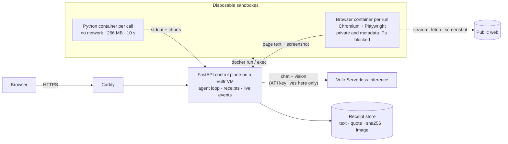

# Research with Receipts

**Research where every claim comes with a verifiable receipt.**

Ask a question. An agent plans the research on Vultr Serverless Inference, then does all the work inside disposable sandboxes on a Vultr VM: it searches, opens pages in a real headless browser, and runs Python for any arithmetic. The answer is a short brief whose every claim links to a **receipt**: the source URL, the exact quote, a screenshot with that quote highlighted, a timestamp and a SHA-256 hash, or the code and output that produced a number. Each claim is then checked mechanically against its receipts and marked `verified`, `partial` or `unverified`.

## Live demo

**https://78-141-218-240.sslip.io** (Vultr Cloud Compute, Amsterdam)

Running a query needs an **access code**, which keeps the Vultr inference credits safe from abuse. Type it in the **Access code** field at the top of the question box, just above the question and the **Research** button. The browser remembers it after the first accepted run. The code comes with the hackathon submission and is not in this repository.

When you self-host, leave `APP_ACCESS_CODE` empty in `.env` to turn the code off.

## Architecture



**The loop.** The model answers with one JSON action at a time (`search`, `fetch`, `screenshot`, `python`, `final`), so any OpenAI-compatible model works. The control plane runs each action in the run's sandbox and turns every page read and every Python run into a receipt. Page text goes back to the model fenced as untrusted content. When code fails, stderr goes back and the model fixes it. For the final answer, the sandboxed browser re-opens each source, highlights the quoted sentence and screenshots it. Each quote is matched against the captured text, and an optional vision model checks the screenshot. Then the sandbox is destroyed.

**Containment.**

| Threat | What stops it |
|---|---|
| Keys stolen by a page or by model-written code | Containers start with an empty environment; keys stay in the control plane |
| `rm -rf /` | Non-root user, read-only root filesystem, throwaway container |
| Infinite loop, fork bomb, memory bomb | Timeouts that force-remove the container, `--pids-limit`, `--memory` |
| Exfiltration from code | Python containers run with `--network none` |
| SSRF to cloud metadata or localhost | Every request and redirect is resolved and private, loopback and link-local IPs are refused; the VM also drops those ranges for containers (`DOCKER-USER`) |
| Prompt injection | Content fenced as untrusted, injection flagged in the live log, and there is nothing to leak |
| Kernel escape | Optional gVisor runtime (`SANDBOX_RUNTIME=runsc`) or sandboxes on a separate throwaway Vultr VM (`scripts/vultr_sandbox_vm.py`) |

Every run streams its timeline over Server-Sent Events. Any run can be exported as a zip with an offline verifier, and any recorded run can be replayed through the same pipeline, labelled as a replay.

## Run it locally

```bash
cp .env.example .env
./scripts/dev.sh                    # http://127.0.0.1:8000
```

With no `VULTR_INFERENCE_API_KEY`, a labelled mock policy plans the research. With no Docker, a labelled mock sandbox serves fixture pages. To use the real sandbox and model:

```bash
./scripts/build_sandbox.sh          # builds rwr-sandbox:latest (Chromium, Python toolbox)
# in .env: VULTR_INFERENCE_API_KEY=...  (Vultr portal > Serverless > Inference)
python scripts/doctor.py            # checks config, Docker, inference and the sandbox tools
SANDBOX_BACKEND=docker ./scripts/dev.sh
```

Tests run offline: `pip install -r requirements-dev.txt && pytest -q`

## Deploy on Vultr

On a Cloud Compute VM (Ubuntu 24.04, 2 vCPU / 4 GB):

```bash
git clone https://github.com/ADreLOI/research-with-receipts /opt/rwr && cd /opt/rwr
sudo bash deploy/setup_vultr_vm.sh <ip-with-dashes>.sslip.io   # Docker, egress guard, image, systemd, Caddy + HTTPS
sudo nano /opt/rwr/.env                                         # VULTR_INFERENCE_API_KEY, APP_ACCESS_CODE
sudo systemctl restart rwr
sudo -u rwr .venv/bin/python scripts/doctor.py
```

Later updates: `sudo bash deploy/update.sh`. All settings are environment variables documented in [`.env.example`](.env.example). Keys never enter a sandbox.

## Demo questions

`python scripts/demo.py [1|2|3]` runs them from the terminal against a running app, and `python scripts/record_demo.py` records them as replayable runs.

1. **Browser and receipts:** How does gVisor isolate containers, and what performance cost does it have compared to runc?
2. **Browser and Python:** What are the three most populous countries today, and what share of the world population do they hold together?
3. **Hostile page:** Summarize the product page at `/demo/hostile` and list its price and colours. The page hides a prompt injection, requests to the metadata service and localhost, and a blocking `alert()`.

`python scripts/containment_test.py` (or **Run containment test** in the UI) throws eight attacks at a fresh sandbox: key theft, `rm -rf /`, an infinite loop, a fork bomb, a 4 GB allocation, network exfiltration, metadata SSRF and localhost access.

## 2-minute pitch

1. **Problem (0:00).** Research agents cite pages they never read, and an agent that browses the open web reads hostile input all day.
2. **Product (0:15).** Ask a question and watch the plan unfold: every page visit and every line of code runs in a throwaway container on Vultr, with reasoning on Vultr Serverless Inference.
3. **Receipts (0:35).** Each claim cites receipts. Open one to see the exact sentence highlighted on the real page, then press Verify to recompute its SHA-256 in the browser.
4. **Numbers (0:55).** Arithmetic is real Python in a network-less container. When it fails, the error goes back and the model fixes it, visibly.
5. **Containment (1:10).** The hostile page tries prompt injection and SSRF. The injection is flagged, the requests are blocked, and the containment test shows eight attacks absorbed with the host untouched.
6. **Close (1:45).** An agent that executes safely and shows its work, built end to end on Vultr.
