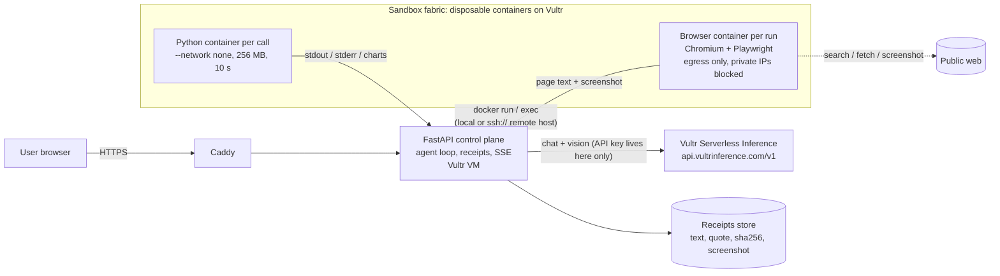

# Research with Receipts

**A web agent that researches a question by driving a real browser and running real code, entirely inside disposable Vultr sandboxes, and answers with claims where every single one links to a receipt.**

A receipt is evidence captured inside the sandbox at the moment the agent read it: the source URL, the exact quote, a SHA-256 hash, a timestamp, and a browser screenshot with that quote highlighted in yellow. Numbers are computed by Python in a network-less container, and the code plus its output are receipts too. Each claim is then checked mechanically against its receipts and labelled `verified`, `partial` or `unverified`.

Built for Vultr Meetup #42 (12h hackathon), Pattern B (sandboxed browser use) with Pattern A (sandboxed code execution) as a tool.

---

## What it shows

| Requirement | How this project meets it |
|---|---|
| VM-based backend on Vultr | FastAPI control plane on a Vultr Cloud Compute VM (`deploy/setup_vultr_vm.sh`) |
| LLM calls via Vultr Serverless Inference | `app/providers/vultr.py`, OpenAI-compatible `https://api.vultrinference.com/v1`; optional vision model checks screenshots |
| Sandboxes never inside the app process | Browser and Python run in Docker containers started per run; optionally on a separate throwaway Vultr VM created through the Vultr API (`scripts/vultr_sandbox_vm.py`) |
| Multi-step agentic workflow | Plan → search → open pages → screenshot → compute → draft → capture evidence → verify |
| Real executed results | Real Chromium screenshots, real page text, real Python stdout; nothing is "described" |
| Containment moment | Built-in **Containment test** button + hostile demo page (prompt injection, SSRF, blocking `alert()`) |
| Process isolation | Non-root, read-only rootfs, `--cap-drop ALL`, `no-new-privileges`, optional gVisor (`SANDBOX_RUNTIME=runsc`) |
| Secret hygiene | Containers start with an empty environment. API keys stay in the control plane. Search with a key (Brave) is called from the control plane, not the sandbox |
| Resource limits | Memory, CPU and PID caps on every container; per-tool and per-run timeouts |
| Lifecycle discipline | One browser container per run, one fresh container per Python call, all removed at the end; orphans reaped at startup |
| Production-style web app | Public URL behind Caddy, live action log over SSE, receipts gallery, run history, shareable run links, optional access code |

## Architecture



### The loop

1. **Plan.** The model on Vultr Serverless Inference gets the question and replies with one JSON action at a time (`search`, `fetch`, `screenshot`, `python`, `final`). This ReAct style works with any OpenAI-compatible model, no tool-calling support required.
2. **Dispatch.** The control plane runs the action in the run's sandbox. Search results are leads only. Every page read creates a page receipt. Every Python run creates a code receipt.
3. **Observe.** Page text goes back to the model wrapped in `<untrusted_content>`. A guard flags instruction-like text (prompt injection) in the live log. If Python fails, stderr goes back and the model fixes its code; the retry is visible.
4. **Draft.** The model returns a summary with `[R#]` markers and a list of atomic claims, each with receipt ids and a verbatim quote.
5. **Capture evidence.** For each claim, the sandboxed browser re-opens the source, finds the quote in the DOM, highlights it and takes a timestamped screenshot.
6. **Verify.** Each quote is fuzzy-matched against the captured text (score 0 to 100%). A claim is `verified` only if the quote matches and was found on the page (or in code output). Optionally a vision model reads the screenshot and must agree.
7. **Destroy.** All containers for the run are removed. The UI shows the lifecycle.

### Containment layers

| Threat | Layer that stops it |
|---|---|
| Model or page asks to dump env vars and keys | Containers get no secrets; env is empty apart from `PATH`/`HOME` |
| `rm -rf /` | Non-root user, read-only root filesystem, throwaway container |
| Infinite loop | In-container timeout, plus host-side timeout that force-removes the container |
| Fork bomb | `--pids-limit` |
| Memory bomb | `--memory` with swap disabled (OOM kill) |
| Data exfiltration from code | Python containers run with `--network none` |
| SSRF to cloud metadata (169.254.169.254) or localhost | Worker resolves every URL and request (including sub-resources and redirects) and blocks private, loopback and link-local IPs; the VM also drops those ranges in `DOCKER-USER` iptables |
| Hostile page JS (`alert()`, downloads) | Dialogs auto-dismissed, downloads disabled, navigation timeouts |
| Prompt injection | Content fenced as untrusted data, system prompt forbids following it, guard event in UI, and even if the model complies the sandbox has nothing to leak |
| Kernel escape | Optional gVisor runtime (`INSTALL_GVISOR=1`, `SANDBOX_RUNTIME=runsc`); optional separate sandbox VM via `SANDBOX_DOCKER_HOST` |

Verified locally with `scripts/containment_test.py` on the Docker backend: all 8 attacks contained (keys absent, `rm` blocked by the read-only FS, loop killed at 10 s, fork bomb hits `EAGAIN`, 4 GB allocation OOM-killed, network unreachable, metadata and localhost requests blocked).

## Repository layout

```
app/
  main.py            FastAPI routes, SSE streams, static UI, hostile demo page
  agent.py           agent loop, tool dispatch, evidence pass, verification, mock policy
  prompts.py         system prompt and repair prompts
  llm.py             shared helpers: robust JSON extraction from model replies
  receipts.py        receipt store, hashing, quote matching, claim verification
  runs.py            run registry, event bus, persistence
  containment.py     containment test battery
  cassettes.py       record / replay of whole runs (demo safety net)
  providers/         LLM provider interface: vultr, mock, replay (+ recording wrapper)
  config.py          all settings from env vars
  sandbox/
    base.py          Sandbox interface
    docker_sandbox.py hardened Docker backend (local or remote DOCKER_HOST)
    mock_sandbox.py  offline fixtures backend for dev and tests (NOT isolated)
    replay_sandbox.py replay and recording wrappers at the sandbox boundary
sandbox_image/
  Dockerfile         Playwright + Chromium + pandas/matplotlib, non-root
  worker.py          runs inside the container: search, fetch, screenshot, python
web/                 index.html, app.js, styles.css (no build step)
demo/hostile.html    deliberately hostile page for the containment moment
demo/cassettes/      recorded runs that can be replayed offline
scripts/             dev server, image build, demo runner, recorder, containment test, inference check
deploy/              Vultr VM setup script, systemd unit, Caddyfile
tests/               pytest suite (runs offline in mock mode)
docs/                2-minute demo script and submission text
```

## Quick start (local, no keys needed)

```bash
cp .env.example .env
./scripts/dev.sh                 # http://127.0.0.1:8000
```

With no `VULTR_INFERENCE_API_KEY` the app uses a deterministic mock policy, and with no Docker it uses the mock sandbox (canned pages, clearly labelled "mock (dev only)" in the UI). Everything else, including receipts, highlighting, verification and the live log, works the same.

To use the real sandbox locally:

```bash
./scripts/build_sandbox.sh       # builds rwr-sandbox:latest (about 3.8 GB, mostly Chromium)
SANDBOX_BACKEND=docker ./scripts/dev.sh
```

To use real reasoning, put your key in `.env` and check the setup:

```bash
VULTR_INFERENCE_API_KEY=...        # from the Vultr portal: Serverless > Inference
python scripts/check_inference.py  # lists models, shows the auto-pick, makes one test call
```

### LLM provider and fallbacks

The agent talks to an `LLMProvider` (`app/providers/`): `VultrProvider` for real runs, `MockProvider` (deterministic, offline), `ReplayProvider` (recorded runs) and a `RecordingProvider` wrapper. The Vultr provider:

* auto-picks a text and a vision model from `GET /v1/models` unless `LLM_MODEL` / `VISION_MODEL` are set;
* retries 429 / 5xx / timeouts with exponential backoff (`LLM_MAX_RETRIES`, honours `Retry-After`), and reports a bad key (401) immediately with a clear message;
* switches to `LLM_FALLBACK_MODEL` if the primary model is missing or keeps failing, and sticks with it for the rest of the run;
* treats the vision check as a bonus: if it fails, the claim keeps its text-based verdict.

If Vultr is unreachable when a run starts, the app replays a matching recording (`DEMO_MODE=auto`), otherwise continues with the clearly labelled mock policy (`LLM_FALLBACK=mock`) or fails with a readable error (`LLM_FALLBACK=none`). `/api/health` reports which provider is active and whether it is reachable.

Run the tests:

```bash
pip install -r requirements-dev.txt && pytest -q
```

## Deploy on Vultr

1. Create a Cloud Compute VM (Ubuntu 24.04, 2 vCPU / 4 GB is enough for 2-3 concurrent runs).
2. Create a Serverless Inference subscription and copy its API key.
3. On the VM:

   ```bash
   git clone <this repo> /opt/rwr && cd /opt/rwr
   sudo bash deploy/setup_vultr_vm.sh            # or: sudo bash deploy/setup_vultr_vm.sh rwr.example.com
   sudo nano /opt/rwr/.env                        # set VULTR_INFERENCE_API_KEY (and APP_ACCESS_CODE for a public demo)
   sudo systemctl restart rwr
   ```

   The script installs Docker, Caddy (automatic HTTPS when you pass a domain), the egress guard, the sandbox image and a systemd service running as an unprivileged `rwr` user.
4. Open `http://<vm-ip>` (or your domain) and press **Run containment test**.

Optional hardening: `INSTALL_GVISOR=1 sudo -E bash deploy/setup_vultr_vm.sh` and set `SANDBOX_RUNTIME=runsc`.

### Vultr as the sandbox fabric (separate throwaway VM)

To keep sandboxes off the app VM entirely, let the Vultr API create a dedicated sandbox VM. Cloud-init installs Docker and the egress guard, locks SSH to the app VM's IP, and builds the sandbox image there; the app then drives it over SSH.

```bash
echo "VULTR_API_KEY=..." | sudo tee -a /opt/rwr/.env      # Vultr portal > Account > API (allow the app VM's IP)
sudo -u rwr /opt/rwr/.venv/bin/python scripts/vultr_sandbox_vm.py create --write-env   # about 5-10 min
sudo systemctl restart rwr
sudo -u rwr /opt/rwr/.venv/bin/python scripts/vultr_sandbox_vm.py destroy --all         # after the event
```

The Vultr API key stays on the app VM. The sandbox VM holds no keys at all. This script has not been run against the live Vultr API yet, so try it early, and keep the local Docker setup as the default if it misbehaves.

## Demo safety net: record and replay

Live demos fail for boring reasons: venue Wi-Fi, a rate-limited search endpoint, a slow model. So every live run is **recorded** (model replies and sandbox results, screenshots included) into its run folder, and any good run can be **replayed** step by step through the same agent loop. Receipts, SHA-256 hashes and verification are recomputed during the replay, and the UI and API label it as a replay everywhere (log, sandbox panel, answer header).

* Before the demo, on the VM: `python scripts/record_demo.py` runs the demo questions live and promotes them to `demo/cassettes/`. Commit that folder.
* Promote any other run: `python scripts/promote_run.py <run_id>`.
* In the UI, a question with a recording shows a **Replay the recorded run** checkbox, and the examples carry a `recorded` tag.
* `DEMO_MODE=auto` (default) runs live, but falls back to the recording when the live model is unavailable. `DEMO_MODE=replay` always replays when a recording exists. `DEMO_MODE=live` never replays. `REPLAY_SPEED` scales recorded latencies (0 = instant).
* Question matching ignores case, punctuation and the host in `/demo/...` URLs, so the hostile-page recording works on any deployment.

The repo ships two seed recordings made before the event (the hostile page with real Docker and Chromium, and an offline mock run). Re-record them on the VM with the real model so the replays show the real thing.

## Configuration

All settings are environment variables; see [`.env.example`](.env.example). The only secret is `VULTR_INFERENCE_API_KEY` (plus `BRAVE_SEARCH_API_KEY` if you choose Brave search). None of them is ever passed to a sandbox.

## API

| Method | Path | Purpose |
|---|---|---|
| `GET` | `/api/health` | backend, model, sandbox mode and limits |
| `POST` | `/api/runs` | start a run: `{"question": "...", "mode": "auto|live|replay"}` (header `X-Access-Code` if configured) |
| `GET` | `/api/runs` | run history |
| `GET` | `/api/runs/{id}` | run with answer, claims, verification, receipts, events |
| `GET` | `/api/runs/{id}/events` | live Server-Sent Events stream |
| `GET` | `/api/runs/{id}/receipts/{rid}` | full receipt (captured text, hash, code, stdout) |
| `GET` | `/api/runs/{id}/receipts/{rid}/image` | receipt screenshot |
| `GET` | `/api/runs/{id}/receipts/{rid}/verify` | recompute a receipt's SHA-256 server-side |
| `GET` | `/api/runs/{id}/export` | zip bundle: manifest, receipts, screenshots, offline report, `verify_bundle.py` |
| `GET` | `/api/recordings` | recorded runs available for replay |
| `GET` | `/api/containment-test` | SSE stream of the containment battery |
| `GET` | `/demo/hostile` | the hostile demo page |

## Demo and pitch

* Demo questions and the terminal runner (`python scripts/demo.py 1`) plus the recorder (`python scripts/record_demo.py`): [`scripts/demo.py`](scripts/demo.py), [`scripts/record_demo.py`](scripts/record_demo.py)
* 2-minute demo script with timings, voice-over and fallback lines: [`docs/DEMO_SCRIPT.md`](docs/DEMO_SCRIPT.md)
* Submission text, ready to paste: [`docs/SUBMISSION.md`](docs/SUBMISSION.md)

## Team

Two people, one day. Suggested split: one person owns the VM, sandbox image and deployment; the other owns the UI, demo questions and the video.

## Limitations and next steps

* DuckDuckGo's HTML endpoint can rate-limit datacenter IPs; the worker falls back to Wikipedia search, and `SEARCH_PROVIDER=brave` gives a sturdier option.
* Quote matching is lexical. A paraphrased claim with an exact quote can still overstate the source; the vision check and the visible quote help a human judge.
* Next: one throwaway Vultr instance per run through the Vultr API, a human approval gate before any form submit, and signing the exported receipt bundles with a server key.
